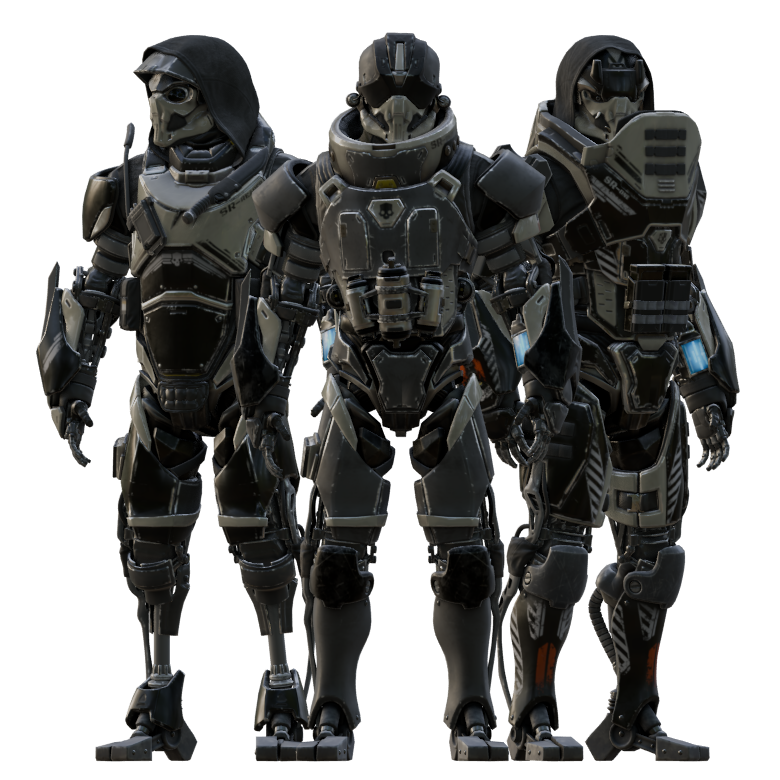

# STEEL REVENANTS
### A Helldivers 2 Cosmetic Mod

## Legal Disclaimer

Steel Revenants is an unofficial, non-commercial fan-made modification for *Helldivers 2*. It is not affiliated with, endorsed by, or sponsored by Arrowhead Game Studios or Sony Interactive Entertainment.

All original game assets, including models, textures, trademarks, and other intellectual property, remain the property of their respective copyright holders.

This project includes original modifications and contributions created by **Nez**. See [LICENSE](https://github.com/nez-dot/Steel-Revenants/blob/abd3e8a58ca1d56d56e78376bf83302904aeaa4a/LICENSE.md) for the terms governing the use of these contributions.

## About the Mod

A cosmetic mod that replaces selected armor sets with robotic prosthetic-based designs, bringing a new mechanical aesthetic to the battlefield.

### Armor Replacements

| Original Armor Set | Replacement |
|---|---|
| RE-1861 / O-3 | SR-Reaper |
| RE-2310 / RS-67 | SR-Ghost |
| RE-824 / KDM-500 | SR-Oni |

## Game Lore

They were taken from the battlefield, broken by the most devastating injuries, with nothing left but their unwavering will to fight for sweet Liberty.

Now, they return to complete their mission, rebuilt with the power of Democratic Steel, forever fused deep into their guts.

**Steel Revenants. Forged in sacrifice. Rebuilt for Liberty.**

## Installation

Install using **Arsenal Mod Manager**.

## Credits and Acknowledgements

Special thanks to:

- **Arrowhead Game Studios** – For creating *Helldivers 2*.
- **HD2 SDK** – For the modding tools.
- **FileDiver** – For game asset exploration.
- **GIMP** – For texture editing.
- **Blender** – For 3D modeling and asset creation.
- **ArcanePoro** – For the modding tutorial.

---

**Steel Revenants – Created by Nez.**
